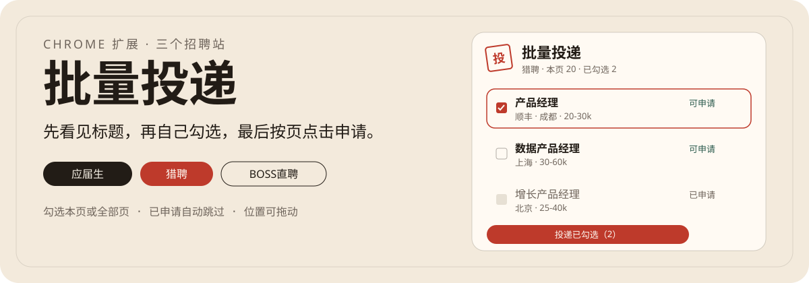

  

在电脑浏览器里打开职位列表，扩展会把标题、公司、城市和薪资收进左侧面板。你筛选、勾选，再让它按页点击页面上的申请或沟通按钮。

  

## 安装

1. 下载或克隆这个仓库。
2. 打开 `chrome://extensions`，打开右上角的开发者模式。
3. 选择「加载已解压的扩展程序」，指向本仓库文件夹。
4. 用你自己的账号登录应届生、猎聘或 BOSS直聘。打开职位搜索页，或猎聘应聘记录 [c.liepin.com/job/record/apply](https://c.liepin.com/job/record/apply)，然后刷新一次。

刚装好如果没看到面板，点浏览器工具栏里的扩展图标。更新代码后，在扩展管理页重新加载，再刷新职位页。

## 怎么用

- 「刷新本页」读取当前列表。
- 搜索框按标题、公司、城市、薪资筛选。
- 「全选本页」只勾当前页里还能申请的岗位。
- 「全选所有页」会从第 1 页翻到最后，先收集标题并勾上，此时还不投递。
- 「投递已勾选」才开始点击。一次超过 30 个时，8 秒内再点一次才会开始。
- 按住面板任意位置拖动，松手后位置会记住。点一下按钮或勾选框不会把面板拖走。

默认每次间隔 1.8 秒，可在面板右侧改成 0.8 到 8 秒。

## 三个网站分别点什么

| 网站 | 打开的页面 | 点击的按钮 |
| --- | --- | --- |
| 应届生求职 | 求职意向或搜索结果 | 立即申请 |
| 猎聘 | 职位搜索、职位详情，或应聘记录 | 有「投简历」就点投简历，否则点「聊一聊」 |
| BOSS直聘 | 登录后的职位搜索 | 立即沟通。若弹出打招呼，会点「发送」 |

已经是「已申请」或「继续沟通」的岗位会跳过。猎聘应聘记录里，「继续聊」和「停止招聘」也会跳过，只点还能发起沟通的「聊一聊」。BOSS直聘如果这页没有分页、要往下滚才加载，读取全部页时会向下滚动收集。

## 它不会做的事

- 不替你登录，不收验证码。
- 不填写或修改简历。
- 不点击「去完善」「去测评」「继续访问」。
- 简历没写完、登录失效、或站点提示次数到上限时，会停下来。
- 卡片上还没有申请按钮时，标成「登录后可投」。登录并刷新后，再勾选。

站点改版后，按钮文字或列表结构变了，就可能读不到岗位。这时先刷新列表；仍对不上，就不要连续重试。

## 文件

扩展本体是 `manifest.json`、`content.js`、`panel.css` 和弹窗页。图标是 `icon48.png`、`icon128.png`。

## 许可

自用的浏览器扩展。请只投你打算申请的岗位，并遵守各网站自己的使用规则。
